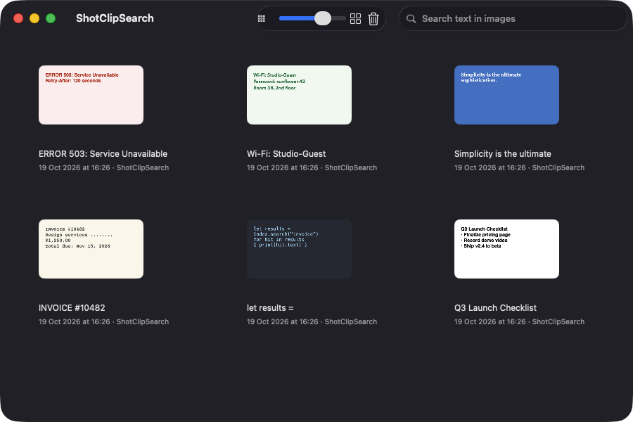
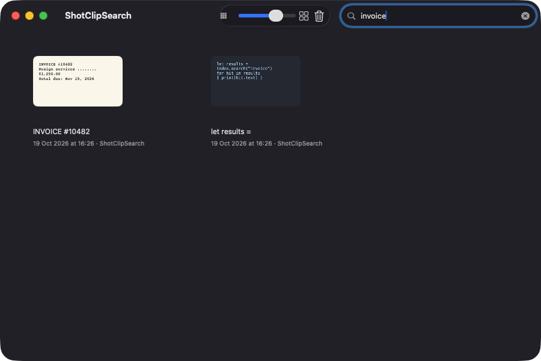
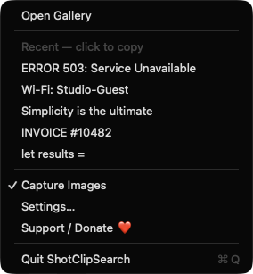
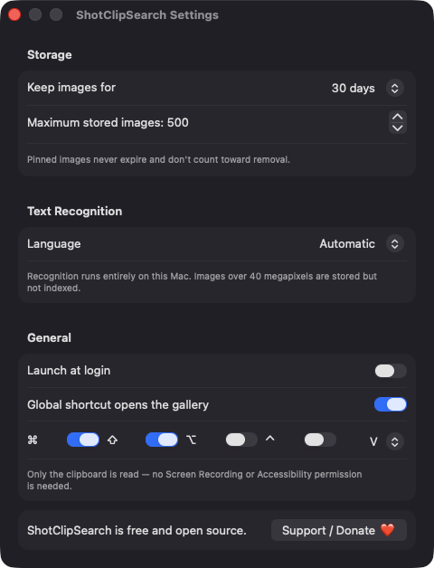

# ShotClipSearch

**🌐 Website:** [turhe123.github.io/shot-clip-search](https://turhe123.github.io/shot-clip-search/)

A clipboard history for images and screenshots where you can search the words inside every picture you copied.

> 🆓 A free, open-source **Cliply alternative** for macOS 14+. Native Swift, no accounts, no subscriptions, MIT licensed.


## Why

ShotClipSearch is a free, open-source, 100% native, backend-free alternative to paid utilities in the *Clipboard* category. It was inspired by Cliply ($9 one-time), and it takes an image-first approach: every picture you copy is kept, and the text inside it is recognized on your Mac so you can find it later by searching for words. There is no server, no account and no network code. Your images stay in a folder on your disk.

## Features

- **Image clipboard history.** Watches the system pasteboard for PNG, JPEG and TIFF images, including screenshots copied with `⌃⇧⌘4`. Text copies are ignored, so it complements a normal text clipboard tool.
- **Search the text inside images.** On-device text recognition (Apple Vision, accurate level) runs in the background, one image at a time. The search field also matches the source app name and the date.
- **Recognition language.** Automatic detection, or pick a specific language from those Vision supports on your Mac.
- **Gallery window.** Adaptive thumbnail grid with the first line of recognized text and a timestamp (plus source app) under each card. A toolbar slider changes the thumbnail size.
- **Keyboard-driven.** Arrow keys to move, Return (or double-click) to copy an image back to the clipboard, Space to preview, Delete to remove.
- **Preview.** A large preview shows the image next to its selectable recognized text and pixel size.
- **Pin.** Pinned images never expire and are kept by *Clear Unpinned*.
- **Menu bar extra.** Open the gallery, click one of the 5 most recent images to copy it, pause or resume capture, open Settings.
- **Global shortcut.** Opens the gallery from anywhere. Default `⌘⇧V`; modifiers and letter are configurable in Settings.
- **Retention controls.** Keep images for 7, 30 or 90 days, or forever. Cap stored images from 50 to 1000. Retention is enforced at launch, after each capture and once a day.
- **Launch at login** (via `SMAppService`).
- **Careful capture.**
  - Duplicate images are detected by hash and bumped to the top instead of stored twice.
  - Pasteboard items flagged as transient, concealed or auto-generated are skipped.
  - When a pasteboard holds both image data and a file URL, the image data is used.
  - Images over 40 megapixels are stored but not recognized and show a *Not indexed* badge.
  - At most 20 images wait for recognition; the oldest are dropped (and marked *Not indexed*) if you copy faster than the recognizer keeps up.
  - If a disk write fails, a banner appears and capture pauses instead of crashing.
  - TIFF data is re-encoded as PNG to keep the folder small.
- **Local storage.** Images, thumbnails and a JSON index live in `~/Library/Application Support/ShotClipSearch/`. *Show in Finder* is in each card's context menu.

## Screenshots

<p align="center"></p>

<p align="center"><em>The gallery window shows every image you copied as a thumbnail card, labeled with the first line of its recognized text and the time it was captured.</em></p>

<p align="center"></p>

<p align="center"><em>Typing &quot;invoice&quot; in the search field filters the gallery to the images whose recognized text contains that word.</em></p>

<p align="center"></p>

<p align="center"><em>The menu bar menu lists the five most recent images to copy back with one click, plus a capture toggle, Settings, and Support.</em></p>

<p align="center"></p>

<p align="center"><em>Settings cover retention, maximum stored images, the recognition language, launch at login, and the global shortcut.</em></p>

## Install

1. Download `ShotClipSearch-macOS.zip` from the [latest release](https://github.com/turhe123/shot-clip-search/releases/latest).
2. Unzip it and move `ShotClipSearch.app` to `/Applications`.
3. Because the app is open source and not notarized, remove the quarantine attribute:

   ```bash
   xattr -cr /Applications/ShotClipSearch.app
   ```

4. Right-click the app and choose **Open** the first time you launch it.

Requires macOS 14.0 or later.

## Build from source

You need Xcode and [XcodeGen](https://github.com/yonaskolb/XcodeGen).

```bash
brew install xcodegen
xcodegen generate
xcodebuild -project ShotClipSearch.xcodeproj -scheme ShotClipSearch -configuration Release -derivedDataPath ./build build
```

The app is produced at `build/Build/Products/Release/ShotClipSearch.app`.

## Permissions

ShotClipSearch does not request any system permission prompts. Based on the code:

| Permission | Needed? | Why |
|---|---|---|
| Accessibility | No | Only the pasteboard is read; the global shortcut uses a Carbon hotkey, which does not need it. |
| Screen Recording | No | The app never captures the screen. It only sees images that you copy to the clipboard. |
| Microphone / Camera | No | Not used. |
| Network | No | No network access; text recognition runs entirely on-device. The only outbound action is opening the Ko-fi link in your browser when you click Support. |
| Login Items | Optional | Only if you enable *Launch at login*. macOS lists it under System Settings › General › Login Items. |

## Built with AI

ShotClipSearch was written by [Claude Code](https://claude.com/claude-code) inside an automated pipeline, from a plain-English spec. No code, binaries or assets from any commercial app were used; it is a clean-room reimplementation of a feature set, not a copy.

What that means in practice:

- The full source is in this repo under the MIT license. Read it before you run it.
- No network calls, no analytics, no third-party dependencies. Only Apple frameworks.
- Ad-hoc signed and not notarized, which is why Gatekeeper warns on first launch.
- It has had less human review than a hand-written app. Bug reports and pull requests are welcome.

## Support ❤️

ShotClipSearch is free and always will be. If it saves you time, you can support its development:

[Support Or (Leo) Davidai ❤️](https://ko-fi.com/leodavidai)

The app also has a *Support / Donate ❤️* button in the menu bar menu and in Settings.

## More free Mac apps

ShotClipSearch is one of [60 free, open-source Mac utilities](https://github.com/turhe123/mac-apps) built the same way: native Swift, no accounts, no telemetry. Browse the full gallery at [turhe123.github.io/mac-apps](https://turhe123.github.io/mac-apps/).

## License

MIT © Or Davidai Bachar
